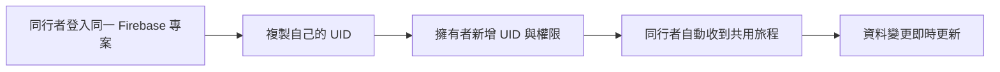

# 共用旅程與成員權限

本功能需要自行部署版本、同一個 Firebase 專案及本版本的 Rules。官方公開體驗站維持本機模式。每個人使用不同的 Email／Password 帳號；不要共用擁有者的密碼。

## 第一次共用

1. 旅程擁有者先完成設定精靈並建立旅程。
2. Firebase 專案管理者到 Authentication → Users，為同行者建立獨立帳號；同行者已在此專案有帳號時直接使用。網站的「新增成員」只授予旅程權限，不會建立 Auth 帳號或寄出邀請信。
3. 同行者在自己控制的 Travel OS 網站，貼上旅程擁有者提供的同一組 Firebase Web config，使用自己的帳號登入。這次要使用既有專案，不要另建另一個 Firebase 專案。
4. 同行者在頁面上方按「複製我的 UID」，私下提供給旅程擁有者。不要提供密碼、service account 或 Admin 私鑰。
5. 擁有者在「旅程成員」貼上 UID，選「檢視者」或「編輯者」，按「新增或修改成員」。
6. 同行者登入同一 Firebase 專案時，新的旅程會從本人索引自動出現。若沒有出現，雙方先核對 Project ID，再重新登入並確認 UID；不同專案的同名帳號不是同一個身分。

UID 是識別碼，不是登入憑證。單憑一段符合格式的 UID，瀏覽器不能確認對方在 Auth 中的帳號是否存在；請由對方登入後複製，避免手動拼寫。

## 權限

| 角色 | 可讀旅程與備份 | 可修改行程／景點／預訂／費用 | 可管理成員 |
|---|---|---|---|
| owner 擁有者 | 是 | 是 | 是 |
| editor 編輯者 | 是 | 是 | 否 |
| viewer 檢視者 | 是 | 否 | 否 |

原擁有者不可被降權、移除，亦不可新增第二個 owner。檢視者的修改入口會停用；繞過介面直接寫入仍由 Firebase Rules 拒絕。所有讀取者都能匯出已獲授權閱讀的內容。

擁有者可按「修改權限」將 UID 帶入表單，或按「移除成員」並再次確認。移除會同步清掉對方的旅程索引與 membership；對方頁面將移除該旅程。已在對方手上的備份或已閱讀的資料無法遠端收回。

## 更新與儲存

舊格式旅程須由 owner 先下載備份並確認升級，editor/viewer 在此之前可閱讀。升級完成後維持原成員權限。所有成員應使用同版或更新版網站，詳見[儲存升級](STORAGE_MIGRATION.zh-TW.md)。

- 其他裝置更新時，開啟中的表單草稿會保留。版本已變更的草稿不能直接覆蓋新資料；請先複製需要的內容，再重新開啟編輯。
- 斷線會顯示狀態。尚未開始的離線寫入會被拒絕並保留表單，待連線恢復後再按儲存。
- 切換專案或登出會停止舊訂閱，清除 access 快取與表單；晚到的舊回呼／儲存結果不會載入新專案。

## 驗證狀態

目前有單元測試及多身分 Firebase SDK Emulator 證據，涵蓋更新、角色變更、撤權、拒寫與停止訂閱。真實 Spark、多裝置瀏覽器及完整新手帳號流程仍待實測；詳見[發布驗收](RELEASE_ACCEPTANCE.zh-TW.md)。

實作依據：[Firebase 即時讀寫](https://firebase.google.com/docs/database/web/read-and-write)。
